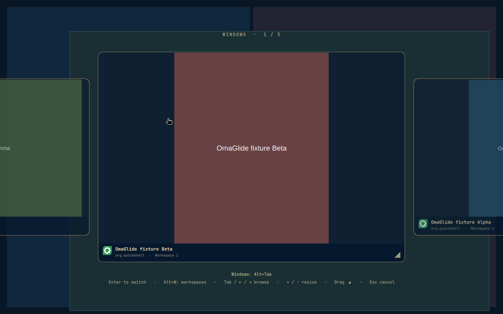

# OmaGlide

A resizable window and workspace switcher for Omarchy. Browse live previews,
pick an open window, or switch to a workspace—all without launching another app.



## Install

Requires Omarchy's Quickshell-based shell (Quickshell 0.3+), Hyprland with Lua
configuration, and window capture support.

```sh
omarchy plugin add https://github.com/hjklcc/omaglide --enable
```

Add this line at the end of `~/.config/hypr/bindings.lua`:

```lua
dofile(os.getenv("HOME") .. "/.config/omarchy/plugins/hjklcc.omaglide/bindings.lua")
```

This assigns **Alt+Tab** and **Alt+Shift+Tab** to OmaGlide, replacing their
existing actions. Then reload:

```sh
hyprctl reload
```

OmaGlide has no menu-bar icon. Open it with **Alt+Tab**.

## Use it

| Control | Action |
| --- | --- |
| Hold Alt and press Tab | Open the switcher; press Tab again to move forward |
| Alt+Shift+Tab | Move backward |
| Press W while still holding Alt | Switch to workspace previews |
| Release Alt | Switch to the selection |
| Arrow keys or mouse wheel | Browse previews |
| Enter or click a tile | Switch to that window or workspace |
| Escape or click the background | Cancel |
| + / − or Ctrl+mouse wheel | Make previews larger or smaller |
| Drag the center tile's lower-right corner | Resize previews |
| 0 | Reset preview size |
| Super+Q | Close the selected window |

Your preview size is remembered. After resizing, press Enter or click a tile
to select it, or Escape to cancel.

The footer shows your current shortcuts. Workspace previews skip empty and
scratchpad workspaces, and keep windows in their relative positions.

## A few things to know

- Previews use the windows' native resolution. Hidden apps may pause updates.
- Workspace previews show windows, not wallpaper or the menu bar.
- Other desktop shortcuts, including media keys, pause while the switcher is open.
- Hold-to-select uses Alt. If you bind a different modifier, use
  `hjklcc.omaglide:toggle` and select with Enter or a click.

OmaGlide runs inside your desktop shell. It doesn't upload previews or make
network requests.

## Remove

Remove the OmaGlide `dofile(...)` line from `~/.config/hypr/bindings.lua`,
then run:

```sh
hyprctl reload
omarchy plugin remove hjklcc.omaglide
```

## Credits

Based on [QuickSwitch](https://github.com/ewweberlin/QuickSwitch) by Ewgeni Weber.
Released under the [MIT license](LICENSE).
